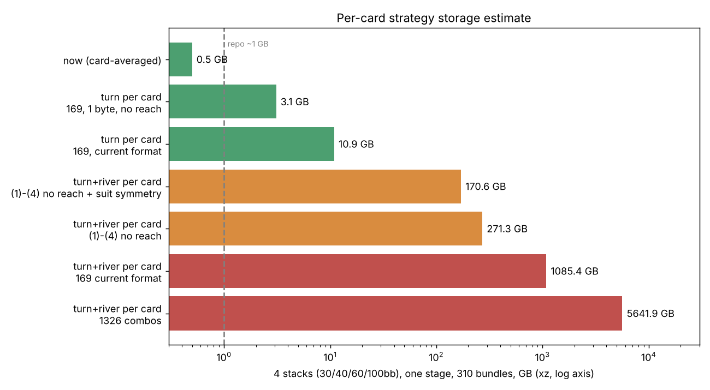

# 턴·리버 전략 카드별 저장 — 비용 측정 (2026-11-08, 브랜치 claude/strategy_percard_20261108)

요청: "턴 리버도 카드별로 다 풀자"(T2 세션). 풀이 값은 그대로, 내보내기만 바꾼 변형의 비용을 잰다. 런타임 연결 없음. 결과를 거꾸로 맞추지 않았다.

## 1. 만든 것
- `tools/gto_fulltree/t2_cont_panel_strategy_percard.patch` — 옛 패치(`t2_cont_panel_strategy.patch`, 그대로 둠) **위에 얹는** 새 패치. `T2_EXPORT_PERCARD=169,1326` 일 때만 동작.
  턴은 턴 카드별, 리버는 (턴, 리버) 카드쌍별로 **모든 행동 노드**(플랍·턴·리버 전부)를 이진 파일로 쓴다. 풀이가 끝난 뒤 읽기만 한다.
- `strategy_percard_measure.py`(풀이 2회+크기·시간·메모리·검증), `strategy_percard_variants.py`(저장 방식별 크기), `strategy_percard_extrapolate.py`(추정 표),
  `strategy_percard_withinclass.py`(169로 합치면 잃는 것).
- 손패 표현: **두 가지 다 쟀다.** 169 = 클래스별(그 카드에서 막히지 않은 콤보만 합침), 1326 = 콤보별(막힌 콤보 제외, 보드 JcTd5h 에서 턴 1128·리버 1081개).
  파일 한 기록 = 줄 번호 + 턴 카드 + 리버 카드 + 도달(f32) + 행동별 빈도(u16 퍼밀). 줄 목록·손패 목록은 보드당 `*.pc.meta.json`.

## 2. 설정과 읽기 전용 확인
보드 JcTd5h(무지개, 무늬 대칭 없음 = 가장 큰 쪽), step1 묶음 A 패널. ft_board.py 재시도 명령과 같다: CFR+, 최대 1000회, 목표 0.3%팟, 25회마다 확인, 스레드 1, 출처키 같음. 난수 없음(결정적).
- 같은 보드를 (R0) 옛 바이너리+옛 내보내기, (R1) 새 바이너리+옛+카드별 내보내기로 두 번 풀어 비교했다.
  **결과 파일(시간·메모리 칸 제외)과 옛 `strategy.json` 이 세 팟 모두 한 글자도 같다.** (3벳 팟은 행렬 소요시간 `matrix.ms` 도 시간 칸이라 제외 — 다른 칸은 전부 같음)
- 카드별 169 파일을 다시 카드 평균으로 합치면 옛 파일과 최대 0.86 퍼밀 차이(옛 파일의 반올림 수준) → 내용이 맞다.
- 처음 만든 판은 리버 첫 노드까지만 써서 "모든 행동 노드"가 아니었다. 고쳐서 전부 다시 풀었다(표는 고친 판).

## 3. 보드 하나 측정값 (JcTd5h, 4코어 컨테이너, 스레드 1)
| 팟 | 풀이 | 반복 | 풀이 시간 | 내보내기 시간 (옛 / 169 / 1326) | 최대 메모리 |
|---|---|---|---|---|---|
| 싱글레이즈 BTN-BB (s1_t01) | 수렴 0.299%팟 | 200 | 13분 | 0.27 / 1.4 / 2.3 초 | 2.13 GB |
| 림프 SB-BB (s1_t04) | 0.284% | 350 | 23분 | 0.30 / 1.2 / 1.8 초 | 2.13 GB |
| 3벳 팟 행렬 (s1_t10) | 0.277% | 125 | 7.5분 + 행렬 9.4분 | 0.19 / 1.1 / 2.0 초 | 1.87 GB |

내보내기는 풀이의 0.1~0.4%라 시간·메모리는 문제 아님(최대 메모리는 풀이가 정하고 내보내기로 늘지 않음).
기록 수: 싱글·림프 99,574개(플랍 6, 턴 784, 리버 98,784), 3벳 90,166개. **리버가 99%.**

| 보드당 크기 (MB) | 옛(카드 평균) | 카드별 169 | 카드별 1326 |
|---|---|---|---|
| 싱글레이즈 원본 / gzip / xz | 0.08 / 0.03 / 0.02 | 143 / 75 / 54 | 913 / 504 / 285 |
| 림프 | 0.08 / 0.03 / 0.02 | 143 / 75 / 54 | 913 / 503 / 285 |
| 3벳 | 0.08 / 0.03 / 0.02 | 127 / 64 / 46 | 812 / 419 / 237 |
(단색 보드 Tc8c5c 싱글: 원본 같음, xz 169=21MB·1326=147MB — 압축률은 보드마다 다름. 풀이 5분.)

## 4. 저장 방식별 (T2 세션 추가 요청, 169 기준, 보드당 xz, 싱글/림프/3벳)
| 방식 | 손실 | 싱글 | 림프 | 3벳 | 비고 |
|---|---|---|---|---|---|
| 기준: 지금 형식(u16+f32) | 없음 | 53.9 | 53.8 | 46.1 | |
| (1) 빈도 1바이트 + 도달 f32 | **있음, 최대 0.2%p (평균 0.07)** | 45.2 | 45.1 | 38.2 | 도달 f32 가 큰 몫 |
| (1) + 도달 f16 | 위 + 도달 반올림 | 30.1 | 29.6 | 25.1 | |
| (2) 무늬 대칭 | 없음 | ×0.63 (보드 72개 평균, 0.29~1.0) | | | 정확히 센 값. 무지개 플랍은 대칭 0 → ×1.0 |
| (3) 자기 도달<1e-4 클래스 생략 | 생략 몫 도달합 5e-6~3e-5 | 41.5 | 37.5 | 27.6 | 항목 26%·32%·48% 생략 |
| (3) <1e-3 / <1e-2 | 6e-5~4e-4 / 7e-4~6e-3 | 34.8 / 27.3 | 30.5 / 22.5 | 20.9 / 10.4 | |
| (4) 순수(한 행동 100%) 클래스는 행동 번호만 | 없음 | 56.3 | 56.2 | 48.1 | 순수 항목 22~31% 인데 **오히려 약간 커짐**(마스크 오버헤드, 압축이 이미 잡음) |
| (1)+(3)+(4), 도달 f16 | (1)(3)과 같음 | 24.9 | 22.4 | 16.8 | |
| 같은 것, 도달 값 생략(마스크만) | 도달은 앞 노드 전략에서 재계산 가능 | 15.1 | 13.7 | 10.8 | 도달이 용량 절반 |
| (5) 카드 묶기 (4/8/16 묶음 종류, 기록 수 558/1388/3694 ← 99,574) | **크다** | 0.55 / 1.3 / 2.9 | | | 묶음 평균과 차이 평균 **17~22%p**, 최대 ≈100%p |
- (5)는 쓸 수 없다: 같은 모양 카드끼리 묶어도 (카드가 내 족보에 닿는지에 따라) 클래스별 전략이 크게 다르다. 묶음 수를 3694까지 늘려도 평균 17%p.
  카드 묶음 기준은 내가 정한 것(짝/무늬/오버카드/연결)이다. 다른 기준이 더 나을 수는 있으나 측정하지 않았다.
- zstd 는 컨테이너에 없어 xz -6 으로 쟀다(zstd 는 보통 xz 보다 10~20% 크다).
- 169 vs 1326 정확도: 169 로 합치면 같은 클래스 안 무늬 차이를 잃는다. 1326 파일에서 잰 값(도달 가중, 행동 중 최대): 클래스 평균과 콤보의 차이가
  **턴 평균 5.7~7.4%p, 리버 4.1~6.0%p**, 최대 ≈96%p. 1326 은 원본 6.4배, xz 5.3배.

## 5. 추정 (보드당 값 = 세 팟을 step1 묶음 비율로 가중: 3벳+ 68%, 싱글 28%, 림프 5%)
묶음 72보드. 스택별 묶음: 30/40/60/100bb = 58/74/80/98(단계당), 합 310. 단계 수 최대 4 가정(계획서 0장).

| 방식 (xz) | 보드 MB | 묶음 MB | 60bb 한 단계(80묶음) GB | 4스택 한 단계(310) GB | 4스택·마지막 단계만·패널 A만 GB | 4스택·4단계·A·B GB |
|---|---|---|---|---|---|---|
| 지금(카드 평균) | 0.02 | 2 | 0.1 | 0.5 | 0.2 | 2.0 |
| **턴만 카드별** 169 지금 형식 (플랍+턴, 보드당 0.49MB) | 0.49 | 35 | 2.8 | 10.9 | 5.5 | 44 |
| 턴만 카드별 169, 1바이트+도달 f16 (0.28) | 0.28 | 20 | 1.6 | 6.3 | 3.1 | 25 |
| 턴만 카드별 169, 1바이트+도달 생략 (0.14) | 0.14 | 10 | 0.8 | 3.1 | 1.6 | 12 |
| 턴만 카드별 1326 (비율로 추정, ≈2.6) | 2.6 | 190 | 15 | 59 | 29 | 235 |
| 턴·리버 카드별 169 지금 형식 | 48.6 | 3,501 | 280 | 1,085 | 543 | 4,342 |
| 턴·리버 카드별 1326 | 252.8 | 18,200 | 1,456 | 5,642 | 2,821 | 22,568 |
| (1) 1바이트+f16 | 26.7 | 1,923 | 154 | 596 | 298 | 2,384 |
| (1)+(3)+(4), 도달 생략 | 12.2 | 875 | 70 | 271 | 136 | 1,085 |
| (1)+(2)+(3)+(4), 도달 생략 | 7.6 | 550 | 44 | 171 | 85 | 682 |
| (5) 묶기 8묶음류 + (1)(3)(4) [손실 큼, 쓰지 말 것] | 0.5 | 36 | 2.9 | 11 | 5.6 | 45 |
(6) 배수: 마지막 단계만 = 1/단계 수(최대 1/4), 패널 하나만 = 1/2. 마지막 열이 "전부 저장", 앞 열이 "마지막 단계·패널 A 만".
(1)~(6) 전부 조합 = 마지막 줄(5)의 마지막-단계·A 열 ≈ 5.6GB, 단 평균 17~22%p 오차라 권하지 않음. 손실 없이(≤0.2%p 양자화만) 갈 수 있는 가장 작은 턴·리버 전체는 85GB.
한계: 보드 한 장(무지개)·팟 3개로 외삽. 압축률은 보드마다 다름(단색은 169 가 2.6배 작음). 무늬 대칭은 보드별 정확값을 썼으나 xz 크기에 비례 적용한 근사.

## 6. git 에 들어가나, 어디에 둘까
- GitHub 파일 한도 100MB: 리버까지 카드별 한 보드는 xz 로도 15~54MB(최선) — 한 묶음 72보드 합치면 0.5~3.5GB 라 **불가**. 저장소 전체도 몇 GB 를 넘기면 clone·push 가 깨진다(권장 1GB 안쪽).
- 턴만 카드별(1바이트·도달 생략): 보드당 0.14MB, 묶음 10MB, 60bb 한 단계 0.8GB, 4스택 한 단계 3GB. 묶음 단위 파일(10~35MB)이면 100MB 한도엔 들어가지만 저장소 크기는 한 단계만으로도 부담.
- **추천**
  1. 리버는 카드별로 저장하지 않는다(용량 99%). 지금처럼 리버 첫 행동 카드 평균만 두거나, 런타임에서 필요한 노드를 그때 푼다.
  2. 턴만 카드별로 저장한다: 169 클래스, 1바이트 빈도, 도달 생략(또는 f16), 묶음 파일 하나(72보드, ~10~20MB), **마지막 단계·패널 A 한 번만** 먼저(4스택 ~1.6~3GB).
     손실은 양자화 0.2%p 이하뿐. 1326 이 필요한지는 4~7%p 평균 차이를 쓰는 쪽이 판단(1326 은 6배).
  3. 저장 위치는 git 이 아니라 객체 저장소(GCS 등)나 릴리스 자산, git 에는 해시·색인(`done.json` 같은 것)과 소형 요약만. 이 컨테이너는 gsutil 이 설치돼 있으나 버킷은 사용자가 정해야 한다.
- 카드 묶기(5)는 오차가 커서 비추천.

## 7. 재현
`sh tools/gto_fulltree/ft_board_setup.sh` → 이 브랜치의 패치를 calc 의 `t2_cont_panel.rs` 에 적용·빌드 → `python3 tools/gto_fulltree/strategy_percard_measure.py s1_t01_A JcTd5h <out>` →
`strategy_percard_variants.py <out> JcTd5h data/ft60/panels/panel_prec_A72.json data/ft60/panels/panel_prec_B72.json` → `strategy_percard_extrapolate.py <싱글> <림프> <3벳>`.
(옛 바이너리 `t2_old` 는 옛 패치만 적용한 것, `t2_new` 는 새 패치. 경로는 FT_BIN_OLD/FT_BIN_NEW.)
